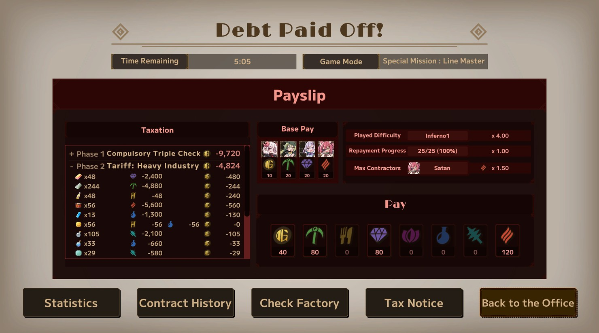
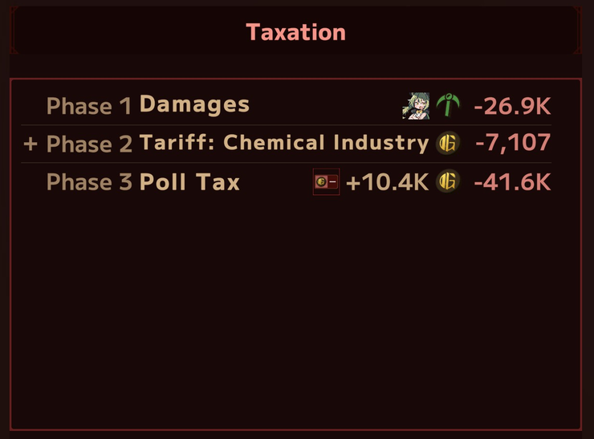
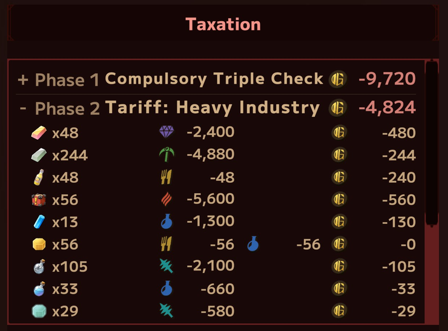
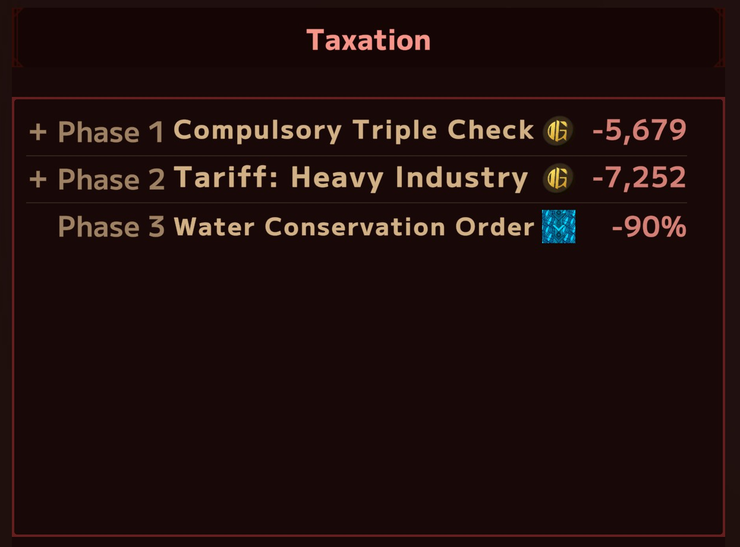
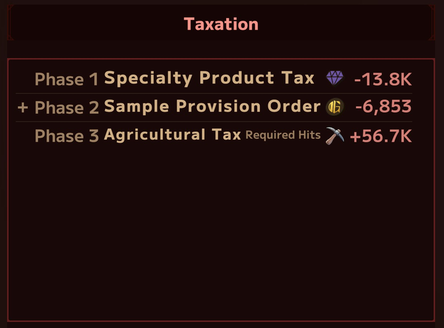
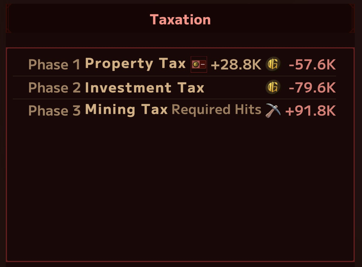
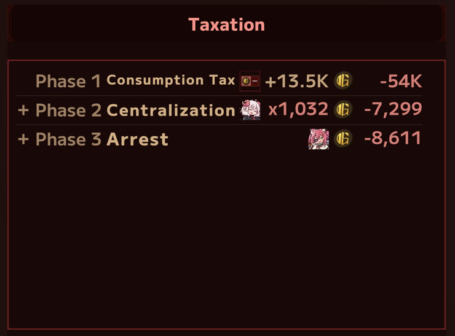

[日本語](README.md)

# LWF Tax Ledger

A **Lazy Witch's Factory** mod that adds a Taxation section to the Payslip.

**[Download the latest release](https://github.com/KiyonakaNata/lwf-tax-ledger/releases/latest)** / **[Thunderstore](https://thunderstore.io/c/lazy-witchs-factory/p/KiyonakaNata/LwfTaxLedger/)** (install with a mod manager)

---

## What you get

The Payslip on the result screen lists what each tax took from the run, phase by phase. Shown on Inferno.

The screenshots use sample data.

### Open a breakdown

Click a row for the items, resources and converted value behind it. Click again to close.

### What each tax reports

| Tax | Value |
|---|---|
| Poll Tax, Property Tax, Consumption Tax | Fixed-cost points, and the total paid across repayments |
| Investment Tax, Damages, Specialty Product Tax | Resources lost |
| Centralization | Sales cancelled, and the items behind them |
| Sample Provision Order, Tariffs | Crafts lost and their value |
| The same, on buff recipes | Buff points lost. Shown in the breakdown only, since buffs cannot repay |
| Mining Tax, Agricultural Tax | Extra hits required |
| Compulsory Triple Check, Arrest | Crafts lost and their value, from the speed loss |
| Water Conservation Order | The transport rate it takes away |
| Withholding Tax | Resources lost |
| Storage Fee, Theft Insurance Premium | Cash not paid, with the item breakdown |
| That's Enough | Sales cancelled, and the items behind them |
| Requisition | Resources taken when it starts (one breakdown row per resource; the total row shows only the repayment resource) |
| Stamp Duty | The rate it takes away |

Property Tax, Investment Tax, Mining Tax

Damages, Tariff: Chemical Industry, Poll Tax

Consumption Tax, Centralization, Arrest

Specialty Product Tax, Sample Provision Order, Agricultural Tax

---

## Install by hand

1. Install **BepInEx 5** — [releases](https://github.com/BepInEx/BepInEx/releases)
   - Download `BepInEx_win_x64_5.4.x.zip`
   - Unpack it into the game folder, next to `LazyWitchsFactory.exe`

     > **Game folder** (Steam)
     > Right-click the game in the library → Manage → Browse local files

2. Start the game once and quit, so `BepInEx/plugins` is created
3. Put `LwfTaxLedger.dll` into **`BepInEx/plugins/`**
4. Play one Inferno run and check the Taxation section on the result screen

## Remove

**This mod only**

- `BepInEx/plugins/LwfTaxLedger.dll`
- `BepInEx/config/kiyonakanata.lwftaxledger.cfg` to drop the settings as well

**BepInEx as a whole** (every mod stops)

- The `BepInEx` folder
- `winhttp.dll`, `doorstop_config.ini`, `.doorstop_version` in the game folder

---

## Settings

`BepInEx/config/kiyonakanata.lwftaxledger.cfg`, created after the first start

**[1. General]**

| Setting | Default | Values |
|---|---|---|
| `Enabled` | `true` | `false` = no Taxation section |
| `Expand breakdown` | `false` | `true` = rows start open |

`[2. Layout]` is text and spacing. No adjustment needed.

`[9. Dev]` is for development. Leave `Enabled` at `false`.

---

## Requirements

| | |
|---|---|
| Lazy Witch's Factory | Tested on **ver 0.30.1** |
| BepInEx | Tested on **5.4.23.5** (5.4.x should work) |
| Difficulty | **Inferno** |

Remove the mod when a game update stops it from working.

## When it does not work

Read `BepInEx/LogOutput.log` first.

| Log | State |
|---|---|
| no `[boot] LWF Tax Ledger ...` | **not loaded** — check where the DLL is |
| `patches=0` | **no hook applied** — the game version does not match |
| `cannot read ...` | **the named value stays 0** — the rest still shows |

When the section does not appear, check:

- The difficulty is Inferno
- The run had a tax at all; the panel is left alone when it did not

Attach both when you report a problem:

- A screenshot
- `BepInEx/LogOutput.log`

---

## Disclaimer

- **Unofficial mod** — not supported by the developer
- Bugs, crashes and save damage that happen with the mod installed are at your own risk
- Made under the [official mod guidelines](https://store.steampowered.com/news/app/3971650/view/699897618302503133)

The source is MIT licensed. Screenshots under `img/` are captures of the game and belong to the developer.
