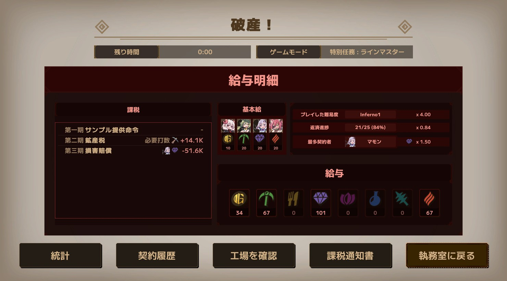
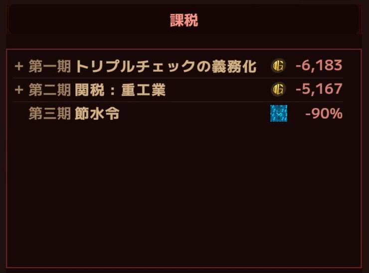
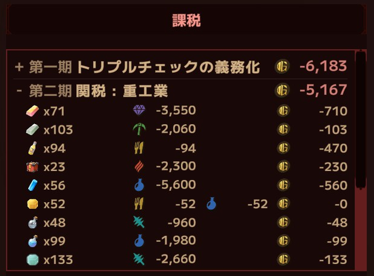
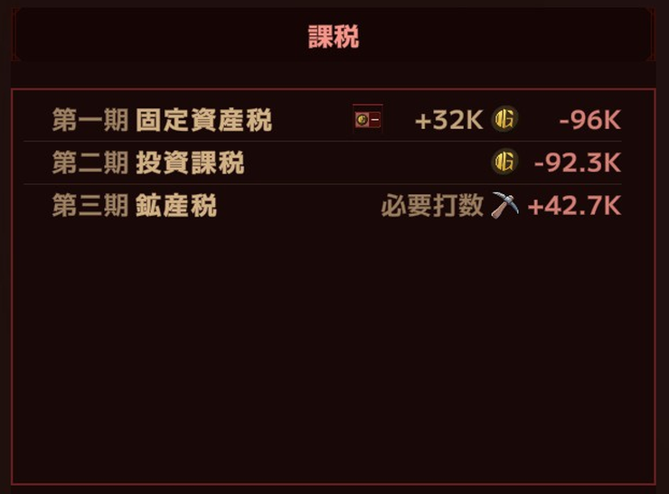
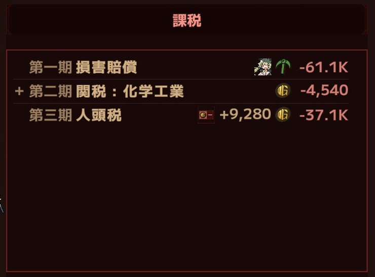
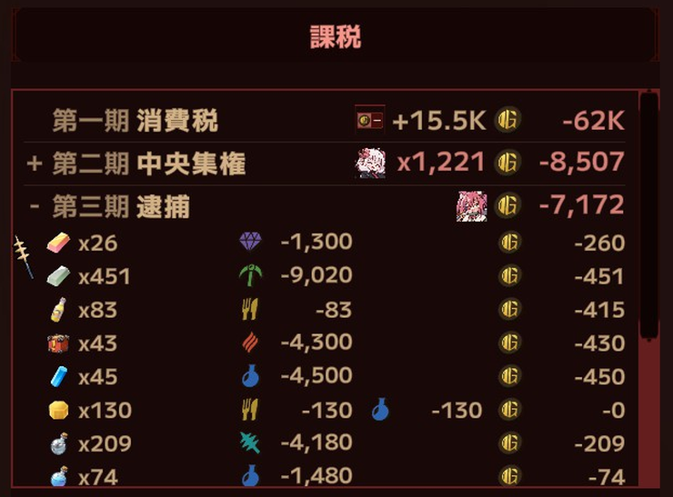
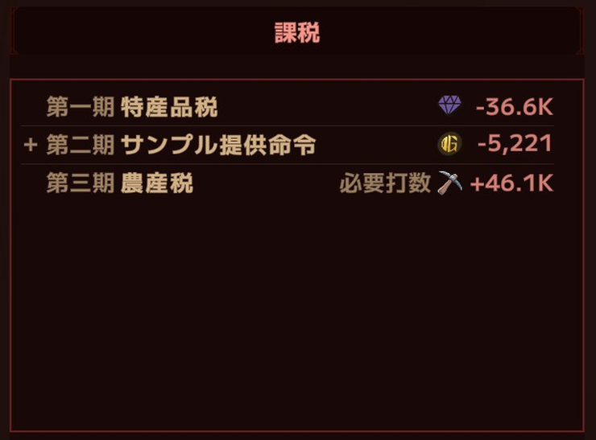

[English](README.en.md)

# LWF Tax Ledger

**Lazy Witch's Factory** 給与明細に課税欄を足す MOD

**[最新版をダウンロード](https://github.com/KiyonakaNata/lwf-tax-ledger/releases/latest)** ／ **[Thunderstore](https://thunderstore.io/c/lazy-witchs-factory/p/KiyonakaNata/LwfTaxLedger/)**（MOD管理ソフトでお手軽導入）

---

## できること

リザルト画面に課税で失ったものを表示する
課税が存在する Inferno でのみ有効

以下の画像はダミーデータ

### 内訳表示

冒頭に「+」を持つ行をクリックすると、アイテムごとの個数・資源・換算額が出る

### 表示内容

| 課税 | 内容 |
|---|---|
| 人頭税・固定資産税・消費税 | 固定費用の点数と支払った合計額 |
| 投資課税・損害賠償・特産品税 | 失った資源 |
| 中央集権 | 無効になった回数とアイテムの内訳 |
| サンプル提供命令・関税 | 減った製作数と換算額 |
| 同上（バフを作るレシピ） | 減ったバフの点。返済に使えないので内訳だけに出る |
| 鉱産税・農産税 | 増えた必要打数 |
| トリプルチェック・逮捕 | 減った製作数と換算額（速度低下からの推定値） |
| 節水令 | 下がった搬送速度の率 |
| 源泉徴収 | 失った資源 |
| 保管手数料・盗難保険料 | 入らなかった現金とアイテムの内訳 |
| もう結構 | 無効になった回数とアイテムの内訳 |
| 徴発 | 開始時に失った資源（資源ごとの額は内訳に。合計行は返済に使う資源の分だけ） |
| 印紙税 | 下がった出現率 |

固定資産税・投資課税・鉱産税

損害賠償・関税 : 化学工業・人頭税

消費税・中央集権・逮捕

特産品税・サンプル提供命令・農産税

---

## 入れかた（手で入れる場合）

1. **BepInEx 5** を入れる — [配布元](https://github.com/BepInEx/BepInEx/releases)
   - `BepInEx_win_x64_5.4.x.zip` を落とす
   - 中身をゲームのフォルダ（`LazyWitchsFactory.exe` と同じ場所）へ展開する

     > **ゲームのフォルダの場所**（Steam）
     > ライブラリでゲームを右クリック → 管理 → ローカルファイルを閲覧

2. 一度ゲームを起動して終了すると、`BepInEx/plugins` などが作られる
3. このMODの zip の中の `LwfTaxLedger.dll` を **`BepInEx/plugins/` に入れる**
4. Inferno を 1 回遊び、結果画面の給与明細に課税欄が出ることを確認する

## 消しかた

**このMODだけ消す**

- `BepInEx/plugins/LwfTaxLedger.dll`
- 設定も消すなら `BepInEx/config/kiyonakanata.lwftaxledger.cfg`

**BepInEx ごと消す**（他のMODも全部止まる）

- `BepInEx` フォルダ
- ゲームのフォルダにある `winhttp.dll`、`doorstop_config.ini`、`.doorstop_version`

---

## 設定

`BepInEx/config/kiyonakanata.lwftaxledger.cfg`（ゲームを一度起動すると作られる）

**[1. General]**

| 項目 | 既定 | 値 |
|---|---|---|
| `Enabled` | `true` | `false` で課税欄を出さない |
| `Expand breakdown` | `false` | `true` で内訳を開いた状態で出す |

`[2. Layout]` は文字と余白。調整不要

`[9. Dev]` は開発用。`Enabled` は `false` のまま

---

## 動作の条件

| | |
|---|---|
| Lazy Witch's Factory | **ver 0.30.1** で動作確認 |
| BepInEx | **5.4.23.5** で確認（5.4.x なら動くはず） |
| 難易度 | **Inferno**（課税があるのはここだけ） |

本体の更新で動かなくなったら消すこと

## うまく動かないとき

まず `BepInEx/LogOutput.log` を見る

| ログ | いまどうなっているか |
|---|---|
| `[boot] LWF Tax Ledger ...` が無い | **読まれていない** — DLL の置き場所を確認 |
| `patches=` の数が 0 | **どの割り込みも当たっていない** — ゲームの版が合っていない |
| `cannot read ...` | **ログが名指しした値だけ 0 になる** — ほかはそのまま出る |

課税欄が出ないときは次の順に見る

- 難易度が Inferno か
- その回に課税があったか（無ければ枠はそのまま）

**不具合の報告**には次の2つを添えること

- 画面の写真
- `BepInEx/LogOutput.log`

---

## 免責

- **非公式のMOD** — 公式のサポート対象外
- MODを入れた状態で起きた不具合・クラッシュ・セーブデータの破損などは自己責任
- [公式のMODに関する方針](https://store.steampowered.com/news/app/3971650/view/699897618302503133)に従って作成

ソースコードは MIT ライセンス（`img/` のスクリーンショットはゲーム画面の写しで、権利は開発元に帰属）
